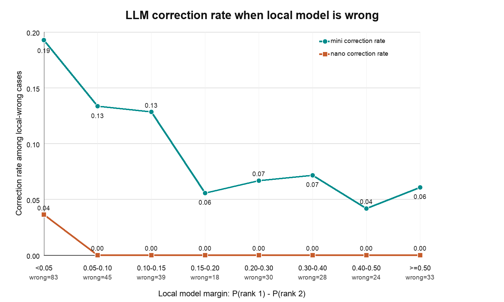
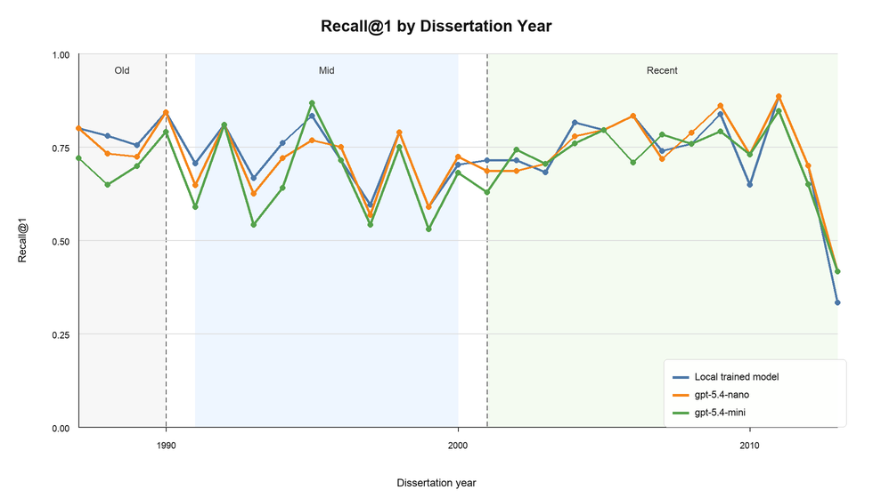

# LLM for Advisor-Advisee Prediction

This repository contains experiment code, prompts, datasets, outputs, and analysis scripts for evaluating LLMs on PhD advisor-advisee relationship prediction from publication metadata.

The paper draft directory `JCDL26-LLM-for-AA/` is kept separate from the reproducibility code and is intentionally ignored by the parent repository.

## Repository Layout

```text
scripts/                    Experiment runners and analysis scripts
prompts/                    Prompt templates used for paper/profile tasks
data/raw/                   Original source data
data/processed/             Processed paper-level and profile-level test sets
results/paper_level/        Paper-level JSONL outputs and metrics reports
results/profile_level/      Profile-level JSONL outputs and metrics reports
analysis/disagreement/      Profile-level disagreement case-study tables
analysis/temporal_disciplinary/
                            Temporal and disciplinary analysis outputs
docs/local_notes/           Local planning/review notes ignored by git
```

## Paper Appendix

The JCDL paper appendix source is maintained locally in `JCDL26-LLM-for-AA/appendixA.tex`. Because that paper draft directory is intentionally ignored by this repository, the reproducible appendix content is displayed here with links to tracked data, results, scripts, prompt templates, and figures.

### Appendix A: Model M Performance on Test Set

The trained probabilistic logistic regression Model M was evaluated on a profile-level test dataset with 1,194 advisees and 21,603 publications. Each advisee has one ground-truth primary advisor, so Precision@1, Recall@1, and F1@1 are equal at rank 1. Model M identifies 74.87% of primary advisors at rank 1 and reaches 96.98% Recall@5.

| Rank | Precision@Rank | Recall@Rank | F1@Rank |
| ---: | ---: | ---: | ---: |
| 1 | 0.7487 | 0.7487 | 0.7487 |
| 2 | 0.4502 | 0.8861 | 0.5971 |
| 3 | 0.3227 | 0.9330 | 0.4796 |
| 4 | 0.2538 | 0.9539 | 0.4010 |
| 5 | 0.2119 | 0.9698 | 0.3477 |

Related files:

```text
scripts/compute_paper_advisor_baselines.py
results/paper_level/paper-advisor-baselines-metrics.txt
```

### Appendix B: LLM Tasks

| Task | Input | Output |
| --- | --- | --- |
| Paper-level classification | Known advisee + one publication | YES/NO/UNCERTAIN; advisor name |
| Profile ranking | Known advisee + up to first 10 publications | Ranked advisor list |
| Profile reranking | Known advisee + up to first 10 publications + Model M top-5 candidates | Reranked advisor list |

Prompt template files used by the experiment scripts:

- [Paper-level classification v2 prompt](prompts/classification_prompt_template_with_prof_v2.txt)
- [Profile ranking prompt](prompts/profile_ranking_prompt_template.txt)
- [Profile ranking v2 prompt](prompts/profile_ranking_prompt_template_v2.txt)
- [Profile reranking v2 prompt](prompts/profile_rereanking_prompt_template_v2.txt)

### Appendix C: Error Analysis

The profile reranking error analysis compares profile-only LLM ranking with the Model-M-assisted reranking setting and reports how often reranking corrects or preserves profile-level decisions.



Related files:

```text
analysis/disagreement/reranking_v2_mini_correction_rate.png
analysis/disagreement/reranking_v2_mini_correction_rate.svg
analysis/disagreement/reranking_v2_margin_frequency.csv
analysis/disagreement/reranking_v2_pub_ordered_profile_disagreements_full_table.csv
analysis/disagreement/reranking_v2_pub_ordered_profile_disagreements_representative_cases.csv
scripts/plot_reranking_margin_frequency.py
```

### Appendix D: Temporal and Disciplinary Analysis

Profile-level Recall@1 is stratified by dissertation year and disciplinary area. Years with fewer than 10 profiles are omitted from the annual figure.



| Disciplinary area | N | Local | `gpt-5.4-nano` | `gpt-5.4-mini` |
| --- | ---: | ---: | ---: | ---: |
| Physical science | 290 | 0.810 | 0.800 | 0.759 |
| Life science | 282 | 0.770 | 0.766 | 0.720 |
| Health science | 277 | 0.661 | 0.661 | 0.621 |
| Social science | 113 | 0.735 | 0.646 | 0.619 |
| Engineering | 107 | 0.785 | 0.785 | 0.738 |

Related files:

```text
analysis/temporal_disciplinary/profile_recall_by_year.png
analysis/temporal_disciplinary/profile_recall_by_year.svg
analysis/temporal_disciplinary/profile_recall_by_year_bin.png
analysis/temporal_disciplinary/profile_recall_by_subject.svg
scripts/analyze_profile_temporal_subject.py
```

## Setup

```bash
python3 -m venv .venv
source .venv/bin/activate
pip install -r requirements.txt
export OPENAI_API_KEY=your_api_key_here
```

Optional:

```bash
export MODEL=gpt-5.4-nano
export PARALLELISM=5
```

## Run Experiments

Run the full paper-level and profile-level experiments:

```bash
bash run_all_experiments.sh
```

By default this uses:

- `data/processed/llm_test_set_at_paper_level.tsv`
- `data/processed/llm_testing_set_advisee_complete_profile_updated.tsv`
- outputs under `results/paper_level/` and `results/profile_level/`

Run a small dry run:

```bash
python3 scripts/run_mentorship_benchmark.py \
  --mode profile-ranking \
  --csv data/processed/llm_testing_set_advisee_complete_profile_updated.tsv \
  --model gpt-5.4-nano \
  --limit 2 \
  --dry-run
```

Run profile ranking on all rows:

```bash
python3 scripts/run_mentorship_benchmark.py \
  --mode profile-ranking \
  --csv data/processed/llm_testing_set_advisee_complete_profile_updated.tsv \
  --model gpt-5.4-nano \
  --limit 0 \
  --max-papers-per-profile 10 \
  --parallelism 5 \
  --output results/profile_level/results-profile-ranking-updated-gpt-5.4-nano-all.jsonl
```

Run v2 profile-only ranking with the ordered publication profile:

```bash
python3 scripts/run_mentorship_benchmark.py \
  --mode profile-ranking-v2 \
  --csv data/processed/llm_testing_set_advisee_complete_profile_updated_pub_ordered.tsv \
  --model gpt-5.4-nano \
  --limit 0 \
  --max-papers-per-profile 10 \
  --parallelism 5 \
  --output results/profile_level/results-profile-ranking-v2-pub-ordered-gpt-5.4-nano-all.jsonl
```

Run v2 profile reranking with local model candidates:

```bash
python3 scripts/run_mentorship_benchmark.py \
  --mode profile-reranking-v2 \
  --csv data/processed/llm_testing_set_advisee_complete_profile_updated_pub_ordered.tsv \
  --model gpt-5.4-nano \
  --limit 0 \
  --max-papers-per-profile 10 \
  --parallelism 5 \
  --output results/profile_level/results-profile-reranking-v2-pub-ordered-gpt-5.4-nano-all.jsonl
```

Run paper-level known-advisee classification on all rows:

```bash
python3 scripts/run_mentorship_benchmark.py \
  --mode paper-known-mentee \
  --csv data/processed/llm_test_set_at_paper_level.tsv \
  --model gpt-5.4-nano \
  --limit 0 \
  --parallelism 5 \
  --output results/paper_level/results-paper-known-mentee-gpt-5.4-nano-all.jsonl
```

Run paper-level known-advisee classification v2 on both `gpt-5.4-nano` and `gpt-5.4-mini`:

```bash
bash scripts/run_classification_v2_gpt_5_4.sh
```

Metrics reports are written automatically next to each JSONL output.

Long runs checkpoint each completed request to the JSONL output file. If a run stops because of quota, network, or another API error, rerun the same command with `--resume` to skip completed `row_numbers`:

```bash
python3 scripts/run_mentorship_benchmark.py \
  --mode profile-ranking-v2 \
  --csv data/processed/llm_testing_set_advisee_complete_profile_updated_pub_ordered.tsv \
  --model gpt-5.4-mini \
  --limit 0 \
  --max-papers-per-profile 10 \
  --parallelism 2 \
  --output results/profile_level/results-profile-ranking-v2-pub-ordered-gpt-5.4-mini-all.jsonl \
  --resume
```

## Standalone Metrics

```bash
python3 scripts/compute_ranking_metrics.py \
  results/profile_level/results-profile-ranking-updated-gpt-5.4-nano-all.jsonl

python3 scripts/compute_classification_metrics.py \
  results/paper_level/results-paper-known-mentee-gpt-5.4-nano-all.jsonl
```

Compute paper-level advisor-name baselines:

```bash
python3 scripts/compute_paper_advisor_baselines.py \
  --csv data/processed/llm_test_set_at_paper_level.tsv \
  --trials 1000 \
  --output results/paper_level/paper-advisor-baselines-metrics.txt
```

## Case Study And Temporal Analysis

Generate profile-level disagreement tables:

```bash
python3 scripts/analyze_profile_disagreements.py
```

Generate temporal and disciplinary analysis tables/figures:

```bash
python3 scripts/analyze_profile_temporal_subject.py
```

The temporal analysis writes outputs to `analysis/temporal_disciplinary/` and also writes the annual Recall@1 figure to `JCDL26-LLM-for-AA/Figures/profile_recall_by_year.png` for use in the paper draft.
